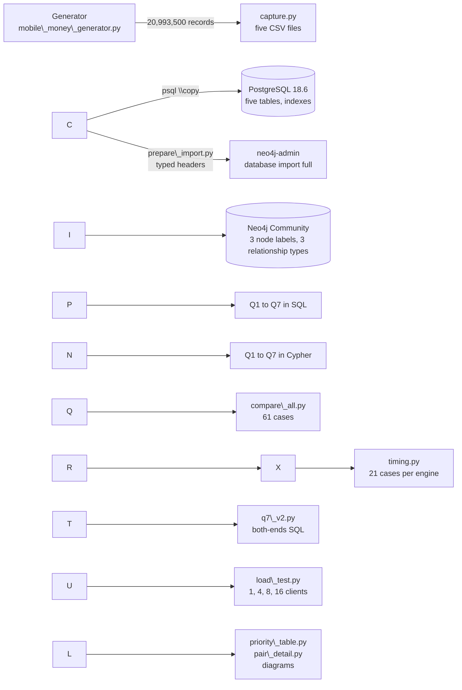

<h1 align="center">Mobile Money Investigations with PostgreSQL and Neo4j</h1>

<p align="center">
Capture, relational and graph models, investigation queries, correctness checks, performance,<br>
concurrency and recommendations for 20,003,300 mobile money transfers, built with PostgreSQL, Neo4j and Python.
</p>

<p align="center">
  
  
  
  
  
</p>

**Course:** Advanced Big Data Analytics, Adventist University of Central Africa (AUCA)<br>
**Project:** Project 2, Mobile Money Investigations (issued 12 October 2026, due 26 October 2026, 11:59 PM CAT)<br>

\---

## Table of contents

1. [Overview](#1-overview)
2. [Key results](#2-key-results)
3. [Architecture](#3-architecture)
4. [Repository structure](#4-repository-structure)
5. [Prerequisites](#5-prerequisites)
6. [Installation and configuration](#6-installation-and-configuration)
7. [Quick start: the connection test](#7-quick-start-the-connection-test)
8. [Full execution guide](#8-full-execution-guide)
9. [Timing protocol](#9-timing-protocol)
10. [Load test protocol](#10-load-test-protocol)
11. [Regenerating the dataset](#11-regenerating-the-dataset)
12. [Script reference](#12-script-reference)
13. [Data model](#13-data-model)
14. [Review accounts](#14-review-accounts)
15. [Verification checklist](#15-verification-checklist)
16. [Troubleshooting](#16-troubleshooting)
17. [Security and secrets](#17-security-and-secrets)
18. [Deliverables](#18-deliverables)
19. [Team](#19-team)
20. [Academic integrity](#20-academic-integrity)

\---

## 1\. Overview

A mobile money provider in Rwanda wants its analysts to explain payment activity and to identify accounts that need
closer review. The supplied generator `mobile\_money\_generator.py` yields **20,993,500 records** for September 2026:
customers, accounts, devices, account-device observations and **20,003,300 transfers**. The generator is used **unchanged**.

The same reports and investigations are built in **PostgreSQL** (relational model) and **Neo4j** (graph model), and the two
are compared for correctness, speed and behaviour under concurrent use.

The project answers four questions:

|#|Question|Report sections|
|-|-|-|
|1|Can the stream be captured, loaded and checked completely in both databases?|1, 2, 3|
|2|How do routine reports (Q1 to Q3) and connected-account investigations (Q4 to Q7) look in SQL and in Cypher?|4, 5|
|3|Do both databases give the same answers, how fast is each, and can one SQL improvement close a gap?|6|
|4|Which model suits which task, how do they behave with several analysts, and which accounts should be reviewed first?|7, 8|

\---

## 2\. Key results

All numbers below are produced by the programs in this repository and are documented, with screenshots, in the report.

|Area|Result|
|-|-|
|Capture|20,993,500 records written to CSV in 179.8 s (0.799 GB); transfer amounts sum to 231,482,327,870 RWF|
|PostgreSQL load|120.6 s load plus 135.9 s of index and constraint setup; 3.727 GB database|
|Neo4j import|1 min 42 s; 704,600 nodes and 20,536,900 relationships; 2.049 GB store; transaction logs 10,626 bytes|
|Correctness|61 of 61 comparison cases match between PostgreSQL and Neo4j (Q1 to Q7), including a rerun at submission|
|Reporting (Q2, full month)|PostgreSQL median 21.5 s; Neo4j did not finish within the 180 s limit|
|Short lookups (Q1, Q3, Q5, Q6)|PostgreSQL 0.5 to 4.6 ms; Neo4j about 18 to 25 ms|
|Shortest route (Q7, bound 6)|First SQL 23,086.1 ms; both-ends SQL 68.3 ms (338 times faster); Neo4j 37.9 ms|
|Load test, 16 clients|Neo4j 354.0 (Q7) and 505.0 (Q4) requests per second; PostgreSQL 32.6 and 71.1, and PostgreSQL stops gaining at 8 clients|
|Investigation order|Review A, B and C before D, E and F (a screening order, not a finding of fraud)|
|Recommendation|PostgreSQL as system of record and for reporting; a read-only Neo4j copy for multi-hop investigation|

\---

## 3\. Architecture



**Components**

|Component|Role|
|-|-|
|PostgreSQL 18.6 (native Windows service `postgresql-x64-18`)|Relational model: five tables, foreign keys, covering indexes and a BRIN index; time zone `Africa/Kigali`|
|Neo4j Community 2026.10.0|Graph model in the default `neo4j` database: `Customer`, `Account`, `Device` nodes; `OWNS`, `USED\_DEVICE`, `TRANSFER` relationships|
|Java 21.0.12.1|Runtime for Neo4j|
|Python 3.13.6 and a virtual environment|All programs (`psycopg` 3.3.6, `neo4j` driver 6.4.1, matplotlib and others)|

\---

## 4\. Repository structure

```
.
├── README.md                          this file
├── Project\_2\_Report.pdf               the full report with screenshots, measurements and recommendation
├── requirements.txt                   Python packages (pip freeze of the environment used)
├── .gitignore                         excludes venv/, CSV files, database stores, import copies and secrets
├── code/                              programs, SQL and Cypher scripts (see section 12)
│   ├── mobile\_money\_generator.py      supplied generator, UNCHANGED
│   ├── mm\_common.py                   shared connection settings, the six review sets, run\_pg and run\_neo
│   ├── capture.py, preview\_streams.py, test\_connections.py
│   ├── schema.sql, load.sql, post\_load.sql, checks\_a.sql, checks\_b.sql
│   ├── prepare\_import.py, neo4j\_setup.cypher, neo4j\_checks.cypher
│   ├── q1.py to q7.py, q7\_path.py, q7\_v2.py, q4\_path.cypher, queries.py
│   ├── compare\_all.py, compare\_summary.py, csv\_checks.py
│   ├── timing.py, timing\_summary.py, plans\_pg.py, plans\_neo.py, plans\_neo\_q2.py
│   ├── load\_test.py, lt\_common.py, load\_summary.py, plot\_load.py
│   └── priority\_table.py, pair\_detail.py, diagram\_cycle.py, diagram\_ownership.py
├── results/                           logs, JSON and CSV measurements, raw repetitions, plans and charts
├── screenshots/                       every screenshot used in the report
└── (local only, NOT in the repository)   CSV files, database stores, temporary import copies
```

\---

## 5\. Prerequisites

|Requirement|Details|
|-|-|
|Operating system|Windows 11. Commands in this guide are for **Command Prompt**|
|PostgreSQL|18.x, running as the service `postgresql-x64-18`; user `postgres`|
|Neo4j|Community 2026.10.0, a dedicated instance with the default `neo4j` database|
|Java|21 (the version required by this Neo4j release)|
|Python|3.13 with `venv` and `pip`|
|Disk space|Up to 10 GB free (CSV files, PostgreSQL and Neo4j stores)|
|Memory|8 GB RAM was used. Run **one database service at a time** for timings and load tests|

\---

## 6\. Installation and configuration

### 6.1 Get the code

```
git clone https://github.com/erneste-uwimpuhwe/101414-101366-101420-mobile-money-investigations-postgresql-neo4j D:\\MobileMoneyProject
cd /d D:\\MobileMoneyProject
mkdir results screenshots
```

### 6.2 Python environment

```
python -m venv venv
venv\\Scripts\\activate
pip install -r requirements.txt
```

### 6.3 Connection settings (no password in files)

Passwords are placeholders in this repository. Set your own values in **every new Command Prompt window**, because Windows
does not keep them between windows:

```
cd /d D:\\MobileMoneyProject
prompt $D $T $P$G
venv\\Scripts\\activate
set PATH=C:\\Program Files\\PostgreSQL\\18\\bin;%PATH%
set PGPASSWORD=your\_password
cls
```

`prompt $D $T $P$G` makes every prompt show the date and time, which the screenshots require. `cls` clears the screen so
the password line is not visible. Check `code\\mm\_common.py` for the database name, user and Neo4j address it uses, and
adjust them to your installation. The Neo4j password is read the same way and must be replaced by your own.

### 6.3.1 Settings used

|Setting|Value|
|-|-|
|PostgreSQL|`shared\_buffers` 1 GB, `work\_mem` 32 MB, time zone `Africa/Kigali`|
|Neo4j for import and timing|heap 2 GB (initial and maximum), page cache 2 GB|
|Neo4j for the load test and the final rerun|heap 1 GB (initial and maximum), page cache 1 GB|

### 6.4 Create the project database (once)

Create an empty PostgreSQL database for the project, set its time zone and run the connection test:

```
psql -U postgres -c "CREATE DATABASE <your\_database>;"
psql -U postgres -c "ALTER DATABASE <your\_database> SET timezone TO 'Africa/Kigali';"
python code\\test\_connections.py
```

The test must report a successful connection to both PostgreSQL and Neo4j.

\---

## 7\. Quick start: the connection test

Start the services you need one at a time and check them:

```
sc query postgresql-x64-18 | findstr /i state
python code\\test\_connections.py
python code\\preview\_streams.py
```

`preview\_streams.py` prints ten records of each of the five streams (`itertools.islice`), which confirms that the
unchanged generator runs.

\---

## 8\. Full execution guide

Run every step from `D:\\MobileMoneyProject` in a window prepared as in section 6.3. Steps depend on the earlier ones.
Timings were measured on the project laptop (Intel Core i5-8250U, 4 cores and 8 logical processors, 8,035 MB RAM) and are
indicative. Each script's first lines show its usage; for example, `q4.py` takes a list of depths.

|Step|Command|Purpose|Report|
|-|-|-|-|
|1|`python code\\capture.py`|Stream all five generator streams to CSV files and write the audit totals (about 180 s)|1.2|
|2|`psql -U postgres -d <your\_database> -f code\\schema.sql`|Create the five tables with keys, foreign keys and checks|2.1|
|3|`psql -U postgres -d <your\_database> -f code\\load.sql`|`\\copy` the CSV files in dependency order (about 121 s)|2.2|
|4|`psql -U postgres -d <your\_database> -f code\\post\_load.sql`|Create the indexes (including the BRIN index) and run `ANALYZE` (about 136 s with constraints)|2.2|
|5|`psql -U postgres -d <your\_database> -f code\\checks\_a.sql` and `code\\checks\_b.sql`|Row counts, audit totals, role counts, validated constraints, indexes and sizes|2.2|
|6|`python code\\prepare\_import.py`|Write temporary typed-header copies of the CSV files and `owns.csv`; the source CSV files stay unchanged|3.2|
|7|Stop Neo4j, then run `neo4j-admin database import full neo4j` with `--id-type=integer`, three `--nodes=Label=file.csv` options and three `--relationships=TYPE=file.csv` options (section 8.1)|Full import into the empty `neo4j` database (1 min 42 s)|3.2|
|8|Start Neo4j, then run `code\\neo4j\_setup.cypher`|Unique constraints on the three business IDs and a range index on `TRANSFER.occurred\_at`; wait until the indexes are online|3.2|
|9|Run `code\\neo4j\_checks.cypher`|Node and relationship counts, roles, one owner per account, unique `transfer\_id`, audit totals|3.2|
|10|Delete the temporary import copies|Keep only the source CSV files|3.2|
|11|`psql -U postgres -d <your\_database> -f code\\trace\_account.sql` and run `code\\trace\_account.cypher`|Trace one account to its owner, a device and an outgoing transfer in both models|3.3|
|12|`python code\\q1.py`, `python code\\q2.py`, `python code\\q3.py`|Routine questions: account activity in an hour, daily activity, shared devices|4.1 to 4.3|
|13|`python code\\q4.py 4 6` then, **after writing predictions**, `python code\\q4.py 8 10`|Ownership and device network: 24 comparisons|5.1|
|14|`python code\\q5.py`, `python code\\q6.py`, `python code\\q7.py`|Rapid onward payments, circular payments, shortest transfer connection|5.2 to 5.4|
|15|`python code\\compare\_all.py` then `python code\\compare\_summary.py`|The 61-case comparison and its status table|6.1|
|16|`python code\\csv\_checks.py`|Independent checks of a device overlap and of a chain and a cycle against the CSV rows|6.1|
|17|One service at a time: `python code\\timing.py`, then `python code\\timing\_summary.py`|21 timed cases per engine, three warm-ups and five measured runs|6.2|
|18|`python code\\plans\_pg.py`, `python code\\plans\_neo.py`, `python code\\plans\_neo\_q2.py`|`EXPLAIN (ANALYZE, BUFFERS)` and `PROFILE` plans for Q2, Q4 (B, depth 10) and Q7 (B, bound 6)|6.2|
|19|`python code\\q7\_v2.py plan`, `python code\\q7\_v2.py check`, `python code\\q7\_v2.py summary`|Both-ends Q7: before and after plans, recheck of 12 cases, retiming of four cases|6.3|
|20|One service at a time: `python code\\load\_test.py`, then `python code\\load\_summary.py pg` and `python code\\load\_summary.py neo`|Load test with 1, 4, 8 and 16 clients, three repetitions each, and its summaries|7.1|
|21|`python code\\plot\_load.py`|Throughput and p95 latency plots for both engines|7.2|
|22|`python code\\priority\_table.py`, `python code\\pair\_detail.py`, `python code\\diagram\_cycle.py`, `python code\\diagram\_ownership.py`|Priority table, detail of pair A and D, cycle and ownership-device diagrams|8.1|
|23|`certutil -hashfile code\\mobile\_money\_generator.py SHA256`|Verify that the generator is unchanged|9.2|
|24|`python code\\compare\_summary.py`|Final rerun of the 61-case comparison|9.2|
|25|`sc stop postgresql-x64-18` and stop Neo4j; check ports 5432 and 7687|Stop the project database services (stores are kept)|9.2|

### 8.1 Import command

The Neo4j import runs with the project database stopped and uses `--id-type=integer`, one `--nodes=Label=file.csv` option
for each of `Customer`, `Account` and `Device`, and one `--relationships=TYPE=file.csv` option for each of `OWNS`,
`USED\_DEVICE` and `TRANSFER`. The file names are the typed-header copies written by `prepare\_import.py`; its log
`results\\prepare\_import\_log.txt` lists them. The complete command used by the group is saved in
`code\\import\_command.txt`.

### 8.2 Notes

* Run **one database service at a time** for steps 17, 19 and 20 so that the two engines do not compete for memory.
* Time zone: boundaries such as 09:45:00 to 10:45:00 CAT are converted to Unix seconds in Python before they reach the queries.
* Neo4j runs with 2 GB heap and page cache for import and timing, and 1 GB each for the load test and the final rerun.

\---

## 9\. Timing protocol

All timings in the report follow the same protocol so that results are comparable:

1. One machine, one database service at a time, persistent connections and fixed resource settings.
2. 21 cases per engine: Q1, Q3, Q5 and Q6 for sets B and E; Q2 for the full month; Q4 for sets B and E at depths 4, 6, 8 and 10; Q7 for sets B and E at bounds 4 and 6.
3. For each case: **three untimed warm-ups** (180 s limit each) followed by **five measured runs** (60 s limit each).
4. Time from submission until the last result row is received (`time.perf\_counter()`); report median, minimum and maximum milliseconds and the PostgreSQL to Neo4j median ratio.
5. Errors and timeouts are recorded separately and never counted as timings. Answers are compared outside the timer.
6. Plans (`EXPLAIN (ANALYZE, BUFFERS)` and `PROFILE`) are collected outside timing.

\---

## 10\. Load test protocol

* Python `multiprocessing` (spawn start method), one persistent connection per client process and a `Barrier` to start all clients together.
* Q4 at depth 10 and Q7 at length-only bound 6 are tested separately, cycling sets A, B and C, with 1, 4, 8 and 16 clients.
* Each client warms up A, B and C once. At barrier release a common start time is set and the deadline is 15 s later; started cycles are finished and the next request is sent immediately. The 60 s query timeout applies.
* Every engine, workload and client count is repeated three times. Each request is logged and its answer checked after timing.
* Throughput is correct completions divided by the time from barrier release to the end of the last cycle. The p95 latency is the sorted successful latency at position `ceil(0.95 n)`. Repetitions are summarised by their median.
* The clients are light processes (no numpy or pandas): an earlier version with heavier clients caused memory errors on the 8 GB laptop.
* Neo4j ran with a 1 GB heap and 1 GB page cache in this test.

\---

## 11\. Regenerating the dataset

The generated CSV files (about 0.8 GB) are kept **local** and are not stored in the repository. To recreate them:

```
python code\\capture.py
```

The program consumes the five `iter\_<stream>()` iterators of the unchanged generator, writes the rows progressively with
`csv.DictWriter`, counts consumed and written rows, logs every million transfers, and checks that the counts match:

|Stream and table|Rows|
|-|-|
|customers|228,000|
|accounts|248,000 (240,000 person, 6,000 merchant, 2,000 agent)|
|devices|228,600|
|account\_devices|285,600|
|transfers|20,003,300|
|**Total**|**20,993,500**|

The generator is deterministic, so the same files can be regenerated at any time.

\---

## 12\. Script reference

Descriptions are summaries; each script's first lines show its usage and arguments.

|Program|Purpose|Output|
|-|-|-|
|`mobile\_money\_generator.py`|Supplied generator, unchanged|records for `capture.py`|
|`mm\_common.py`|Connection settings, the six review sets A to F, `run\_pg` and `run\_neo`|imported by the others|
|`test\_connections.py`|Check the PostgreSQL and Neo4j connections|printed status|
|`preview\_streams.py`|Preview ten records of each stream|printed records|
|`capture.py`|Stream to five CSV files and compute the audit totals|CSV files, `results\\capture\_log.txt`, `results\\capture\_audit.json`|
|`prepare\_import.py`|Typed-header import copies and `owns.csv`|temporary files, `results\\prepare\_import\_log.txt`|
|`draw\_pg\_schema.py`, `draw\_graph\_schema.py`|Draw the relational and graph schemas|schema diagrams|
|`q1.py`|Q1 account activity in the review hour|`results\\q1\_results.json`|
|`q2.py`, `plot\_q2.py`|Q2 daily activity, reconciliation and charts|`results\\q2\_daily.csv`, charts|
|`q3.py`|Q3 shared devices|`results\\q3\_results.json`|
|`q4.py`, `plot\_q4.py`, `q4\_path.cypher`|Q4 ownership and device network, count-versus-depth plot, a supporting path|`results\\q4\_results.json`, `results\\q4\_count\_vs\_depth.png`|
|`q5.py`, `q5\_detail.py`|Q5 rapid onward payments and one chain|`results\\q5\_results.json`|
|`q6.py`, `q6\_detail.py`|Q6 circular payments and one cycle|`results\\q6\_results.json`|
|`q7.py`, `q7\_path.py`|Q7 shortest transfer connection and supporting paths|`results\\q7\_results.json`|
|`q7\_v2.py`|Both-ends Q7 (`plan`, `check`, `summary`)|`results\\timing\_pg\_v2.jsonl`, `results\\q7\_selected.txt`|
|`queries.py`|Shared SQL and Cypher query text|imported by the others|
|`compare\_all.py`, `compare\_summary.py`|The 61-case comparison and its status table|`results\\compare\_61\_status.csv`|
|`csv\_checks.py`|Independent checks against the captured CSV rows|printed checks|
|`timing.py`, `timing\_summary.py`|21-case timing per engine and its summary|`results\\timing\_pg.jsonl`, `results\\timing\_neo.jsonl`, `results\\timing\_summary.csv`|
|`plans\_pg.py`, `plans\_neo.py`, `plans\_neo\_q2.py`|PostgreSQL and Neo4j plans|printed plans|
|`load\_test.py`, `lt\_common.py`|Concurrent load test and its shared helpers|`results\\load\_pg.jsonl`, `results\\load\_neo.jsonl`|
|`load\_summary.py`|Every repetition and the median of the 16 combinations|printed tables|
|`plot\_load.py`|Throughput and p95 plots against client count|`results\\load\_plots.png`|
|`priority\_table.py`, `pair\_detail.py`|Priority table for A/D, B/E and C/F; detail of pair A and D|printed tables|
|`diagram\_cycle.py`, `diagram\_ownership.py`|Cycle diagrams (A and C) and the ownership-device network around account 998|diagrams|
|`check\_screenshots.py`|Check that every expected screenshot exists|printed status|

SQL and Cypher scripts: `schema.sql` (tables), `load.sql` (`\\copy` loads), `post\_load.sql` (indexes and `ANALYZE`),
`checks\_a.sql` and `checks\_b.sql` (counts, constraints, indexes and sizes), `trace\_account.sql` and `trace\_account.cypher`
(trace one account), `neo4j\_setup.cypher` (constraints and index), `neo4j\_checks.cypher` (import checks).

\---

## 13\. Data model

**PostgreSQL (five tables)**

|Table|Columns|Key|
|-|-|-|
|`customers`|`customer\_id` INTEGER, `region` TEXT|`customer\_id`|
|`accounts`|`account\_id` INTEGER, `customer\_id` INTEGER, `role` TEXT (`person`, `merchant`, `agent`)|`account\_id`; FK to `customers`|
|`devices`|`device\_id` INTEGER, `access\_type` TEXT|`device\_id`|
|`account\_devices`|`account\_id`, `device\_id` INTEGER; `first\_day`, `last\_day` SMALLINT (0 to 29); `observations` INTEGER|(`account\_id`, `device\_id`); FKs to `accounts` and `devices`|
|`transfers`|`transfer\_id` BIGINT, `sender\_id`, `receiver\_id` INTEGER, `occurred\_at` BIGINT (Unix seconds), `amount\_rwf` INTEGER|`transfer\_id`; FKs to `accounts` (both ends)|

Every column is `NOT NULL`; amounts and observations are positive; `0 <= first\_day <= last\_day <= 29`.
Indexes: `accounts(customer\_id, account\_id)`, `account\_devices(device\_id, account\_id)`, `transfers(sender\_id, occurred\_at)`
including `receiver\_id, amount\_rwf, transfer\_id`, `transfers(receiver\_id, occurred\_at)` including `sender\_id, amount\_rwf, transfer\_id`,
and a BRIN index on `transfers(occurred\_at)`.

**Neo4j**

|Element|Properties|
|-|-|
|`(:Customer)`|`customer\_id`, `region`|
|`(:Account)`|`account\_id`, `role`|
|`(:Device)`|`device\_id`, `access\_type`|
|`(Customer)-\[:OWNS]->(Account)`|none|
|`(Account)-\[:USED\_DEVICE]->(Device)`|`first\_day`, `last\_day`, `observations`|
|`(Account)-\[:TRANSFER]->(Account)`|`transfer\_id`, `occurred\_at`, `amount\_rwf` (every transfer is a separate relationship)|

Totals: 704,600 nodes and 20,536,900 relationships (248,000 `OWNS`, 285,600 `USED\_DEVICE`, 20,003,300 `TRANSFER`).
Unique constraints exist on the three business IDs and a range index on `TRANSFER.occurred\_at`.

\---

## 14\. Review accounts

|Set|Review account|Destination (Q7)|September date|
|-|-|-|-|
|A|998|24755|6|
|B|147228|186823|13|
|C|206978|6573|8|
|D|237998|21755|6|
|E|144228|183823|13|
|F|203978|3573|8|

The review hour is 09:45:00 inclusive to 10:45:00 exclusive, CAT, on the listed date. Q5 and Q6 start from the review
account within that hour; Q7 uses the destination; Q4 and Q3 use the review account only.

\---

## 15\. Verification checklist

After a full run, these values confirm that the results are reproduced:

|Check|Expected|
|-|-|
|Capture|20,993,500 records; 179.8 s; CSV total 0.799 GB; transfer sum 231,482,327,870 RWF|
|PostgreSQL row counts|228,000, 248,000, 228,600, 285,600 and 20,003,300; roles 240,000 person, 6,000 merchant, 2,000 agent|
|Neo4j counts|704,600 nodes; `OWNS` 248,000; `USED\_DEVICE` 285,600; `TRANSFER` 20,003,300; 20,536,900 relationships|
|Storage|PostgreSQL 3.727 GB; Neo4j store 2.049 GB|
|Comparison|`compare\_summary.py` shows 61 cases, 61 matches, 0 mismatches|
|Q7 before and after (set B, bound 6)|23,086.1 ms to 68.3 ms; set E 23,527.8 ms to 121.9 ms; all 12 lengths still match|
|Load test|Every repetition of both engines finished with 0 wrong answers, 0 errors and 0 timeouts|
|Generator|SHA-256 `2ea0e59d2b7b987d84a3d151bd9d1ad7b3052bfbc25abf1466c8e94467e9455a`|
|Stopped services|`postgresql-x64-18` is STOPPED; nothing is listening on ports 5432 and 7687|

Timings vary between machines and runs; row counts, totals and answers do not.

\---

## 16\. Troubleshooting

|Symptom|Cause and fix|
|-|-|
|`'psql' is not recognized`|The PATH is reset in every new window. Run `set PATH=C:\\Program Files\\PostgreSQL\\18\\bin;%PATH%`|
|`password authentication failed`|`PGPASSWORD` is not set in this window. Run `set PGPASSWORD=your\_password` with your real password (no spaces around `=`)|
|Neo4j import refuses to run|The database must be stopped and empty. Stop Neo4j and remove a previous `neo4j` database before importing again|
|`neo4j.bat` fails with `UnsupportedClassVersionError`|The Java on the PATH is older than 21. Set `JAVA\_HOME` to the Java 21 folder and open a new window|
|`Address already in use`|Another service is using port 5432 or 7687. Check with `netstat -ano \| findstr ":7687"`|
|Q2 in Neo4j times out|Expected: its plan reads all 20,003,300 relationships (report section 6.2). The PostgreSQL result is the reference|
|Memory errors during the load test|Close other programs, run one database service at a time and keep the clients light (no numpy or pandas)|
|PostgreSQL restarts in recovery mode|The machine ran out of memory during a heavy test. Wait for recovery, then repeat the test with fewer other programs open|
|`FileNotFoundError` for a file in `results`|Create the folders first: `mkdir results screenshots`|

\---

## 17\. Security and secrets

* **No password is stored in this repository.** Passwords are placeholders such as `your\_password`; set real values only in your own Command Prompt window.
* Before pushing, check that no real password appears in any file. This command must print nothing:

```
  findstr /S /I /M "YOUR\_REAL\_PASSWORD" \*.py \*.sql \*.cypher \*.md \*.txt \*.json \*.jsonl \*.csv \*.log
  ```

* Keep these **out of the repository**: the CSV files, the PostgreSQL and Neo4j database stores, the temporary import copies, `venv/`, `start\_session.bat` and any file that contains a password.
* After pushing, run `git ls-files` and confirm that none of the items above are listed.

\---

## 18\. Deliverables

|Deliverable|Where|
|-|-|
|Report (PDF), with screenshots, summaries, charts, evidence and individual notes|`Project\_2\_Report.pdf` (also submitted separately)|
|Screenshots used in the report (command, result, taskbar and clock)|`screenshots/`|
|Code: capture and import programs, definitions, queries, checks and benchmarks|`code/`|
|Raw results, repetitions and plans|`results/`|
|Generator, unchanged|`code/mobile\_money\_generator.py`|
|This README|`README.md`|

**Generator integrity.** The generator is submitted byte for byte as issued. Its SHA-256 hash is
`2ea0e59d2b7b987d84a3d151bd9d1ad7b3052bfbc25abf1466c8e94467e9455a`; check it with:

```
certutil -hashfile code\\mobile\_money\_generator.py SHA256
```

\---

## 19\. Academic integrity

The supplied generator `mobile\_money\_generator.py` is the only code provided by the course and is submitted unchanged.
All capture, import, query, comparison, timing, load-test and analysis code in this repository was written by the group.
Assistance from an LLM and how it was checked are declared in Section 8.3 of the report.

